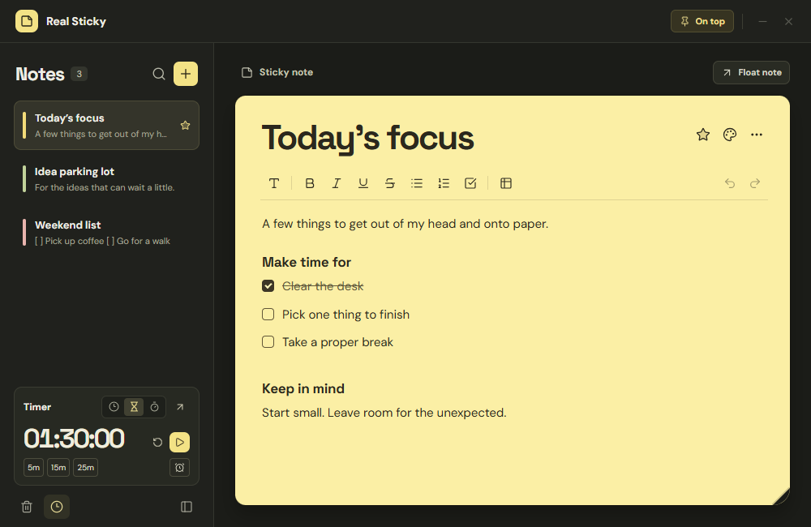

# Real Sticky

Keep notes and time tools visible while you work. Real Sticky is a Windows desktop app built with Rust and Tauri. Float an editable note or a multi-hour countdown in its own compact, always-on-top window.

## [⬇ Download for Windows x64](https://github.com/fakhrul62/real-sticky/releases/latest/download/Real-Sticky-Windows-x64-Setup.exe)

[Portable ZIP](https://github.com/fakhrul62/real-sticky/releases/latest/download/Real-Sticky-Windows-x64-Portable.zip) · [All releases and checksums](https://github.com/fakhrul62/real-sticky/releases)

Run the installer, or extract the portable ZIP and open `real-sticky.exe`. The portable build requires Microsoft Edge WebView2 Runtime. Both downloads are for 64-bit Windows.



## What you can do

- **Keep notes in view.** Float any note, drag it by the handle beside its title, and use the pin to control whether it stays on top. The sliders icon reveals the editing tools when you need them.
- **Write and organize.** Use headings, bold, italic, bulleted and numbered lists, checklists, and editable tables. Choose from 18 note colors, search titles and contents, star favorites, duplicate notes, and restore them from Trash.
- **Track time.** Click the timer digits to enter a custom countdown, such as `45`, `5:30`, or `2:15:00`. Use the arrow beside the time tools to float the timer, world clock, or stopwatch. Countdown controls stay in sync between the sidebar and the floating timer.
- **Keep the taskbar clear.** Use the minimize icon to hide a window to the Windows notification area. Click the Real Sticky tray icon to restore your windows, or right-click it to hide all windows or quit.

## Keyboard shortcuts

| Shortcut | Action |
| --- | --- |
| `Ctrl+N` | Create a note |
| `Ctrl+F` | Search notes |
| `Ctrl+Z` | Undo an edit |

## Local storage

Notes autosave to `%APPDATA%\com.realsticky.desktop\notes.json`. Real Sticky works offline after installation. Its always-on-top behavior follows Windows desktop window rules.

## Build from source

Install Rust, a Windows linker supported by your Rust toolchain, Node.js, npm, and Microsoft Edge WebView2 Runtime. Then run:

```powershell
git clone https://github.com/fakhrul62/real-sticky.git
cd real-sticky
npm ci
npm run tauri dev
```

Build the Windows installer with `npm run tauri build -- --bundles nsis`. The installer lands in `src-tauri/target/release/bundle/nsis/`.
